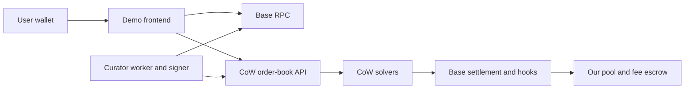

# Base MAG7 demo

Status: implemented in `demo/` with the factory request-ID extension. See the [runbook](../demo/README.md) for configuration, local execution and validation. Production deployment, funding and live acceptance/fill validation remain operator steps; no production order has been submitted. This document does not authorize deployment, funding or live order submission.

## Objective

Build a demo on Base that displays a configured list of supported pools, reads their current state through RPC, and demonstrates curator-signed orders settling through production CoW Protocol. The demo starts with a preconfigured MAG7 basket. A user can explore it, deposit all seven constituent assets, and return over subsequent days to observe production CoW rebalances as market prices change. B20 compatibility and executable liquidity remain prerequisites.

The underlying contract design and signing format are described in [Curated standing orders](curated-standing-orders.md) and [Curator operations](curator-operations.md).

## Selected demo scope

The user-facing flows are pool creation and initialization, exploring supported pools, proportional deposits, and proportional withdrawals. Users bring all required stock tokens; there is no single-USDC entry flow in this version. Each pool detail page exposes **Deposit** and **Withdraw** actions, the wallet's position, current allocations, target weights, and CoW rebalance activity.

The initial MAG7 preset uses the same weights as `../folio`. Verified against `../folio/contracts/script/DeployFolioLocal.s.sol` (the `symbols` and `weights` arrays), also documented in `../folio/README.md`:

| Asset     | Base token | Target weight | Pool denormalized weight |
| --------- | ---------- | ------------- | ------------------------ |
| NVIDIA    | NVDAc      | 20%           | `8e18`                   |
| Microsoft | MSFTc      | 15%           | `6e18`                   |
| Apple     | AAPLc      | 15%           | `6e18`                   |
| Amazon    | AMZNc      | 15%           | `6e18`                   |
| Alphabet  | GOOGLc     | 15%           | `6e18`                   |
| Meta      | METAc      | 10%           | `4e18`                   |
| Tesla     | TSLAc      | 10%           | `4e18`                   |

The pool weights sum to `40e18` and reproduce Folio's normalized allocation. Use asset addresses to preserve this mapping regardless of token enumeration order. Once a pool is finalized, read its actual weights on-chain; the frontend preset does not override deployed state.

Selected operating behavior:

- A server-hosted curator evaluates the watched MAG7 pool approximately hourly using CoinGecko USD token prices.
- Each hourly cycle considers all seven assets, prioritizing larger USD allocation gaps. It executes eligible overweight-to-underweight rebalances sequentially, checking the pool curve and a CoW quote before each signed ERC-1271 order with canonical hooks.
- Orders live for at most **180 seconds**, with at most **one live order per pool** managed by this curator. An hourly cycle can execute multiple orders, one after another.
- Start with an asset drift floor of **more than $0.10** and require each proposed correction to exceed its estimated execution/gas costs. No database or persisted allocation/performance history is required for this demo.
- The curator private key is provided through a server-only environment variable. The pool creator controls replacement through `setCurator`.
- The public pool catalog contains explicitly frontend-whitelisted and curator-registered pools. A user also sees pools created through the UI and stored only in that browser's local cache. Creation does not register or publish a pool. Neither path scans logs.

## Wallet flows and pool catalog

### Explore pools

Merge the public frontend whitelist with locally cached UI-created pools, deduplicating by `(chainId, poolAddress)`. Validate addresses and read all financial state through RPC. Creation writes the catalog entry only to that browser's local cache, not to a server-side pool directory or either whitelist. Other browsers/devices do not automatically discover it. Clearing local storage removes those local catalog entries, not the deployed contracts or the user's LP holdings. This is local catalog visibility, not on-chain privacy: the pool and its state remain public on Base.

A user-created pool becomes part of the shared demo only through explicit registration in **both** the curator watchlist and the frontend whitelist. Initially this is an operator-managed configuration change; creating the pool does not automatically request, approve or perform registration. The initial public/curated pool is the preconfigured MAG7 example.

Registration must validate the chain, factory membership, supported token/weight configuration, finalized state, and that the pool's current curator matches the server signer. Keep the two whitelist configurations consistent before publishing a public catalog entry. Curator registration alone does not publish a pool, and a local cache entry never grants curator access. Setting the server's curator address on-chain is not itself watchlist enrollment.

Label local entries as locally saved and, where applicable, not enrolled for automated rebalancing. After registration, show the pool once even if it is also cached locally. A temporarily offline curator does not remove an already registered public pool; show its actual service status.

### Create and initialize a pool

The initial flow offers the MAG7 preset and the fixed Folio weights above. Arbitrary assets and editable weights are outside the initial preset unless added explicitly later. The user chooses a pool name/symbol and seed amounts; an initial basket USD value can be used with cached prices to suggest amounts at the target weights. Show the actual intended seed amounts and allocation before confirmation.

1. Confirm Base network, wallet balances, selected curator address, three-minute order duration and curator fee settings. Expose only the curator's public address to the browser; obtain it from server/application configuration.
2. Create a pool through the configured factory using a unique client-generated creation request ID and retrieve its address through the direct-read lookup described below. The connected creator wallet remains the initial pool controller and immutable creator.
3. Approve the new pool to pull the seven seed amounts, then bind each token with its preset weight. Binding transfers the user's seed tokens to the new pool.
4. Set the protective direct-swap fee to `MAX_FEE` and verify it on-chain.
5. Finalize after every token, balance and setting is verified. Check relayer allowances, LP supply, initial LP ownership and finalized status by direct reads.
6. Store the pool in that browser's local catalog and open its detail page. Do not mutate server catalogs or whitelists. Show it as locally saved and not automatically enrolled for rebalancing; public listing requires subsequent explicit curator and frontend registration.

This is a resumable sequence of wallet transactions with the current contracts. Persist the creation request ID before sending the creation transaction, then the pool address and progress. On refresh or retry, derive progress from receipts and contract state; do not deploy twice, bind a token twice or finalize an incomplete pool. Provide a pre-finalization recovery path for the controller to unbind seeded assets if initialization is abandoned. No atomic setup router is assumed.

### Required factory lookup for creation without logs

The existing factory returns the new address from `newBPool`, but a standard transaction receipt does not expose that return data. Existing `isBPool(address)` validates an already known address; it does not discover the result of a submitted creation. Predicting the next CREATE address from a sampled factory nonce is not sufficient under concurrent creations.

Add a factory creation entry point that takes a unique `requestId` and records `(creator, requestId) -> poolAddress` in persistent storage, with a public getter. Namespace IDs by the actual caller; reject duplicate IDs without overwriting the previous pool. Record the mapping atomically with successful creation and preserve creator/controller assignment and factory registration. The UI can read this mapping after receipt success or recover it after a reload, without decoding logs or requiring tracing. Existing creation entry points can remain for other callers. This lookup recovers a known creation request; it is not an enumerable pool directory, a curator registration, or a frontend whitelist. No getter of all factory pools is required for the selected catalog design.

This extension is implemented by `createPool` and `createdPool` in `BCoWFactory`. Tests must cover two concurrent creators, multiple request IDs, duplicate-ID rejection, reverted creation leaving no mapping, and address recovery after client reload. Events may still be emitted by contracts; the app does not consume them.

### Deposit

The user holds all seven assets. Select an LP-share amount or a desired deposit value and compute the required proportional token amounts from **current reserves and total LP supply**, respecting the contract's integer rounding. Deposits follow current reserve proportions, which can differ from target USD weights while a rebalance is pending.

Show required amounts, wallet balances, allowances and expected LP shares. Obtain approvals where necessary, refresh reserves and simulate `joinPool(poolAmountOut, maxAmountsIn)` before submission. Use explicit amount bounds; if reserves move outside them, refresh the preview rather than silently changing the deposit. Confirm the resulting position through RPC.

### Withdraw

The user selects LP shares or a percentage of their position. Preview all seven constituent outputs from current reserves and supply, then simulate and call `exitPool(poolAmountIn, minAmountsOut)` with explicit amount bounds. Confirm the reduced LP balance and received tokens through RPC. Withdrawal returns the constituent tokens; it does not automatically sell them for USDC.

## Curator evaluation and order lifecycle

### Hourly market snapshot

Run one evaluation approximately every hour for the configured watched MAG7 pool. Read all reserves and weights at a consistent block. Batch all seven token prices into one CoinGecko request where the selected free endpoint supports it; use verified token IDs/address mappings, not ticker-only lookup. Cache the result on the server and reuse it for the frontend's USD view, so browser visits do not multiply CoinGecko requests.

Use CoinGecko's free public/Demo access; an API key may be configured server-side if the selected endpoint requires one. Request update timestamps where supported, back off on rate limits, and skip signing when any required price is missing, nonpositive or stale. Do not substitute an underlying stock quote for a token quote without explicitly applying the share multiplier; do not multiply a token price twice. The selected freshness threshold is 1,800 seconds from the upstream update timestamp. Keyless multi-address requests currently fail with a one-contract limit; the implementation falls back to seven spaced single-address requests once per hour, caching the result. See [CoinGecko's simple price endpoint](https://docs.coingecko.com/demo/reference/simple-price) and [rate-limit guidance](https://docs.coingecko.com/docs/errors-and-rate-limits).

For each token `i`, compute:

```text
quantity_i = rawReserve_i / 10^decimals_i
value_i = quantity_i * tokenUsdPrice_i
portfolioValue = sum(value_i)
actualWeight_i = value_i / portfolioValue
targetValue_i = targetWeight_i * portfolioValue
gap_i = value_i - targetValue_i
```

A positive gap is overweight; a negative gap is underweight. At the start of a cycle, rank all seven assets by absolute USD gap, highest first. An asset qualifies for a rebalance candidate when its absolute gap is **greater than $0.10**. If the priority asset is overweight, sell it toward the largest remaining deficit; if it is underweight, buy it using the largest remaining excess. Cap the proposed correction by both sides' gaps, available reserves and Balancer quote limits.

This threshold is a drift filter, not a claim that $0.10 is profit or that every such order will fill. For each candidate, estimate the actual execution/gas costs, converted to USD, and require the proposed correction to be larger than those costs. Include costs reflected in the CoW quote without counting the same charge twice. The curve check and executable quote remain mandatory. Use token-denominated quote costs with the cached token prices; if a separate ETH-denominated gas estimate is needed, obtain an ETH/USD conversion with the same low-frequency price budget. No separate percentage-drift threshold is required initially.

### Sequential pass through all assets

Each hourly iteration is a bounded pass through all seven assets, not a single-order attempt:

1. Take the batched CoinGecko price snapshot and a consistent on-chain reserve snapshot. Rank assets by the absolute USD correction needed.
2. Prepare the largest eligible remaining correction, check curve/quote/cost viability, then post at most one order.
3. Wait for a confirmed fill, confirmed invalidation, or expiry before considering another order. An ambiguous submission or unresolved settlement must not release the one-live-order guard.
4. After a fill, re-read **all** reserves, recompute portfolio value, targets and gaps, and re-rank the remaining assets. Do not execute an entire queue using pre-trade amounts: prior fills, fees and user liquidity actions can change them.
5. If the candidate has no executable quote, cannot satisfy the curve, or costs too much, log the reason and continue to the next remaining candidate. If its order expires unfilled, mark that attempt expired and continue to the next candidate after expiry is established. Do not loop on one failing asset or immediately repost the same expired attempt indefinitely.
6. Finish when every asset has been considered as the priority asset for this cycle, remaining gaps are at/below the floor, or no eligible correction remains. An asset can be a counterparty in multiple trades, but is not retried indefinitely as the priority asset within one cycle. Remaining drift is reconsidered at the next hourly cycle.

Reuse the cycle's price snapshot only while it satisfies the configured freshness bounds. Recheck freshness before every signature; if the data becomes stale during the sequential pass, stop the remaining pass and log the reason rather than trade against stale prices. Keep one evaluation running per pool; do not overlap hourly cycles or build a backlog of concurrent cycles.

This is a pair-selection and sizing baseline, not an assumption that one pass will restore the exact seven-asset target. Smaller executable sizes may be tested when the full proposed size cannot pass the curve/quote checks; the sizing search must be bounded.

### Curve, quote, sign and post

1. Check the pool's current curator and epoch against the configured signer, and reconcile the single-live-order state before preparing a new order.
2. Build the proposed pair and amount from the USD snapshot. Quote the pool curve with zero CoW swap fee, respecting its amount limits; the protective direct-swap fee does not set the CoW order's curve baseline.
3. Request an executable CoW quote for the intended trade. Compare net received amounts and applicable execution/protocol costs against the pool curve and intended limit. A valid USD rebalance is not automatically a curve-valid trade.
4. Choose the final sell amount and minimum buy amount, then re-read reserves and run `verify` against the final order. The final payload must retain the contract's requirements, including zero order `feeAmount`, sell kind, ERC20 balance markers and fill-or-kill. Do not blindly copy quote fields that violate those requirements. How current CoW quote/protocol-fee policy interacts with these orders is part of production acceptance validation.
5. Derive the final canonical appData, including `commit(h0, buyAmount)` and `transferFee()` hooks, and sign `(order, epoch)` with the server curator key. Amount/deadline changes require rebuilding the commitment, appData and signature; any quote used must remain applicable to those final fields and hooks.
6. Post the appData and ERC-1271 order to the production Base order book, retaining the deterministic order UID, final payload, evaluation time and expiry. No curator on-chain transaction is required for ordinary posting.
7. Monitor the order through CoW's API and known transaction receipt status. Show fills, expiry or failure in the demo; refresh pool/escrow state through RPC. An expired or unfilled order is not a successful rebalance.

### Three-minute lifetime; one live order

The pool's immutable `orderDuration` is 180 seconds for the demo, and each signed order's `validTo` is at most 180 seconds after signing. Quote/submission latency must still leave enough validity for the order book's minimum requirement. The hourly cadence is a **decision cadence**, not an hour-long order lifetime. An hourly evaluation can continue through multiple sequential candidates after fills or established expiries. It does not wait an hour between assets, and it does not launch independent continuous repricing jobs between hourly cycles.

There are two different constraints:

- **Already enforced on-chain:** one committed pool order per settlement transaction. The transient lock prevents two orders from consuming the same starting reserves in one batch.
- **Selected curator policy:** at most one live signed order per pool across the order book. The current contract permits several separately signed orders to be live, so this additional restriction must be maintained by the worker.

Serialize order creation per pool in a single active worker process. Retain the active order UID and exact signed payload in memory before submission, and retry that same payload on an ambiguous network response rather than sign a different live order. Do not sign a replacement until the previous order is confirmed filled, invalidated, or strictly past its `validTo` according to chain time. API absence alone is not proof that a previously signed order cannot settle. Early invalidation can use on-chain epoch revocation. Stop posting after curator replacement.

### No database; restart behavior

Use configuration files for the whitelists, browser storage for local pool entries, and in-memory curator cycle/order state. Do not add a database, a durable order ledger or persisted hourly allocation snapshots. CoW's API and current RPC reads supply order/fill activity and pool state. Persisted analytics, portfolio history and performance charts are deferred.

Because active-order memory is lost on restart, startup must conservatively drain any old order window before signing. Stop the previous worker before starting its replacement, reconcile any orders visible through CoW, and wait until chain time has advanced strictly beyond the startup chain timestamp plus the 180-second maximum order lifetime (with an implementation margin if needed). This covers a correctly bounded order signed by the previous process even if the API cannot find it. Do not use wall-clock sleep alone as proof of chain expiry, and do not run multiple independent signing workers for the same pool.

Order-status polling during each three-minute lifecycle does not require re-fetching CoinGecko prices. After restart, expose unknown/reset in-memory status honestly until a fresh evaluation runs. Service stdout/stderr logs are operational diagnostics, not a project database or a complete financial-history source.

## Curator operation and ownership

Run the curator on its server, with the signing private key in a server-only environment variable such as `CURATOR_PRIVATE_KEY`. The browser receives public configuration and cached observations only; no public environment variable, frontend bundle or API response contains the signing key.

The wallet creating a pool is its immutable creator and controls `setCurator`. This authority is independent of the curator's server and the pool's liquidity-controller role. The demo exposes the current creator and curator; a creator-only replacement action can use the existing contract method. Detect a mismatch between the on-chain curator and the worker signer and stop posting for that pool. Replacing the curator does not transfer fees already earned by the old curator.

The physical host, job process manager, initial funding amounts and public demo domain remain implementation/deployment choices. There is no database or server-side history-store requirement. No extra key-custody service is required by this initial design.

## Demo acceptance scenario

1. Open the app and see the preconfigured, finalized MAG7 pool on Base, using Folio's target weights.
2. Connect a wallet holding the seven stock assets, inspect its proportional deposit preview, approve tokens as needed and deposit successfully.
3. Observe the LP position and current allocation on the pool detail page; be able to withdraw the position into all seven constituents.
4. Keep the curator running over subsequent days. After market movement creates executable drift above the floor and costs, observe an hourly cycle considering all seven assets in priority order, with eligible production CoW fills executed sequentially and no overlapping live orders. Every order has at most three minutes of validity.
5. Reconcile the updated pool reserves, unchanged LP supply during the trade and any curator fee through direct reads. The UI distinguishes a completed fill from an evaluation that skipped or expired; it does not promise a trade every hour or exact target weights after one fill.
6. Independently create and initialize another MAG7 pool through the UI. Confirm that it survives page reload in that browser's local catalog and supports deposit/withdrawal without log queries. A fresh browser must not list it, and the worker must not curate it. After explicit registration in both whitelists, a fresh browser lists it and the curator can enroll it in hourly evaluations.

## Architecture: what “CoW integration” means

“CoW integration” describes the code that connects our demo to CoW's existing order book and settlement contracts. It does not mean another user-facing app, a separate order book, or a solver operated by us. Users can stay in the demo to inspect their basket and its rebalances.

There are three responsibilities:

| Component          | Responsibility                                                                                                                                                    | Execution                                               |
| ------------------ | ----------------------------------------------------------------------------------------------------------------------------------------------------------------- | ------------------------------------------------------- |
| Demo frontend      | Load supported pools from configuration, read holdings and settings, display orders and fills, and let users submit liquidity transactions through their wallets. | Browser, with optional server routes if needed.         |
| Curator worker     | Read reserves and prices, choose curve-valid orders, build canonical appData, sign orders, submit them to CoW and monitor their lifecycle.                        | A background process with access to the curator signer. |
| CoW infrastructure | Accept orders, run solver competition and settle successful trades, including the order's hooks.                                                                  | Existing production CoW services and contracts on Base. |

The frontend and curator worker can live in this repository as one demo project. A background worker is useful because order maintenance must continue when nobody has the website open. It is a separate execution process; it does not need to be a separate app for users. It runs on the curator server; the specific host and process management remain implementation choices.

The curator key remains outside the browser, supplied through the curator server's environment. The creator retains on-chain curator-replacement authority.



“RPC-driven frontend” means on-chain state comes from direct contract reads. The demo does not scan or decode logs, subscribe to contract events, or require a custom indexer. CoW's off-chain order book and the curator worker remain part of the architecture.

## Data responsibilities

### On-chain data through RPC

Maintain explicit frontend whitelist and curator watchlist configuration for registered pools. Each entry identifies the chain ID, pool address, expected factory, supported contract version and display label. The browser additionally loads its locally cached UI-created pools, without automatically enrolling them in server curation. No deployment block or factory-event search is required.

Validate the connected chain, deployed code, expected pool interface, `FACTORY()` and factory membership through `isBPool(pool)`. Read mutable settings and financial state on-chain; do not hardcode reserves, weights, curator addresses or balances. A configured pool that fails validation is shown as unavailable rather than silently substituted with another address.

The existing contracts expose the reads needed for the initial demo:

| Display or action           | Direct read                                                                                                         |
| --------------------------- | ------------------------------------------------------------------------------------------------------------------- |
| Pool constituents           | `isFinalized()`, then `getFinalTokens()` for a finalized pool.                                                      |
| Holdings and target weights | `getBalance(token)`, `getDenormalizedWeight(token)` and `getTotalDenormalizedWeight()`.                             |
| Token amounts and labels    | Token `decimals()`, `symbol()` and `name()`, with display fallbacks for missing metadata.                           |
| Pool settings               | `getSwapFee()`, `getController()`, `creator()`, `curator()`, `minEpoch()`, `orderDuration()` and `curatorFeeBps()`. |
| Wallet LP position          | Pool `balanceOf(wallet)` and `totalSupply()`; proportional underlying amounts can be estimated from reserves.       |
| Deposit readiness           | Constituent token `balanceOf(wallet)` and `allowance(wallet, pool)`.                                                |
| Unwithdrawn curator fees    | `feeEscrow()` and escrow `claimable(curator, token)` for each constituent token and known beneficiary.              |

Batch compatible reads at a common block for a consistent snapshot. Refresh through periodic reads or new-block notifications, without contract-event subscriptions. Wallet actions can use simulation, transaction hashes and receipt status for confirmation without decoding receipt logs. The precise RPC provider and refresh policy are open decisions.

### Limits of avoiding logs

Current-state reads and proportional joins/exits need no contract changes for this approach. Recovering a UI-created pool address without logs requires the factory lookup extension described above. Current storage is not a transaction-history database:

- Deposit/withdrawal history, the list of all past LPs and a wallet's LP cost basis cannot be reconstructed from the exposed current-state getters.
- `claimable(curator, token)` is the remaining withdrawable amount. It falls when fees are withdrawn and is not a lifetime-earned counter. The contracts also do not enumerate past curators or store per-fill fee records.
- Current reserves and weights do not provide a historical NAV, P&L or APY series. Such metrics need additional historical state and price data. Historical RPC reads can sample known blocks where the provider supports them, but do not by themselves identify every past action.
- Polling shows successive snapshots; it does not guarantee capture of every intermediate reserve change. Balance changes alone must not be labeled as individual trades or deposits.

For the initial demo, show current holdings, estimated current value, current LP position and withdrawable fees. Obtain CoW order/fill history from CoW's API. Omit complete liquidity history, cost basis, lifetime fees and performance charts until a separate data source or explicit contract storage supports them. No feature may silently fall back to scanning logs, including receipt-log parsing or tracing transactions to reconstruct events.

A strict requirement to use only Base JSON-RPC would exclude outstanding CoW orders and their off-chain status. This draft retains the previously proposed CoW API connection; the no-logs requirement applies to our frontend and worker. CoW's own internal indexing is outside the demo.

### Order data through CoW's API

Read a pool's submitted orders, their status and fills from CoW; use this existing API for activity history rather than adding a demo database. The API exposes paginated account orders and owner-filtered trades, including settlement transaction hashes; these provide the rebalance activity list and latest CoW fill without event searches. The curator submits canonical appData and ERC-1271 orders through the same integration. Outstanding orders cannot be discovered solely from RPC because they are stored off-chain.

Production Base API: `https://api.cow.fi/base/api/v1/`. See the [CoW API guide](https://docs.cow.fi/cow-protocol/integrate/api) and [order-book reference](https://docs.cow.fi/cow-protocol/reference/apis/orderbook).

Whether the frontend calls the API directly or uses a server route is an implementation choice, not a requirement for a separate app.

### Market prices

Use CoinGecko token USD prices on the hourly curator cadence, cached server-side for both allocation analysis and the frontend. CoW quotes establish executable pricing for order preparation. Neither cached USD prices nor NAV reference values alone establish that a trade is executable or curve-valid. See the curator lifecycle above for sizing, freshness and quote checks.

## MAG7 token check — November 25, 2026

A complete candidate set exists on Base (chain ID 8453): Coinbase Tokenized Stocks, using Base-native B20 tokens. Use this Coinbase MAG7 set for the demo preset, subject to the required B20 compatibility tests; no pool has been funded or deployed for this demo yet.

| Company   | Token  | Base token address                           |
| --------- | ------ | -------------------------------------------- |
| Apple     | AAPLc  | `0xb200000000000000000000C2e324d24d7eEcd1fb` |
| Amazon    | AMZNc  | `0xb200000000000000000000d9192b6B456483C2E8` |
| Alphabet  | GOOGLc | `0xb2000000000000000000002D0BA3164cc74f58B7` |
| Meta      | METAc  | `0xb2000000000000000000008bC8786B856E61707C` |
| Microsoft | MSFTc  | `0xB200000000000000000000Ab99cFa739E253872B` |
| NVIDIA    | NVDAc  | `0xb20000000000000000000078ee7ce2fE4908108C` |
| Tesla     | TSLAc  | `0xb2000000000000000000001e800a7f5189430cD0` |

Address sources: [Base's official stock listings](https://brand.base.org/stocks) and the [Coinbase Tokenized Stocks API](https://api.coinbase.com/v1/tokenized-stocks?page_size=500&include_zero_supply=false). The API was checked with pagination accounted for: 138 positive-supply records returned, with no next page. All seven tokens returned eight decimals and positive supply through direct Base RPC reads at block **62,195,116**. The RPC symbols matched the issuer symbols.

### CoW token lists and pricing

Exact, case-insensitive `(chainId, address)` comparison against `cowprotocol/token-lists` found:

| List                                                                                                                                                             | MAG7 candidate membership                                                                     |
| ---------------------------------------------------------------------------------------------------------------------------------------------------------------- | --------------------------------------------------------------------------------------------- |
| [Default `CowSwap.json`](https://github.com/cowprotocol/token-lists/blob/1f2e5c1476a4940b8c780d1a833d61ebeef57685/src/public/CowSwap.json)                       | None of the seven. Published default list also checked at `files.cow.fi/tokens/CowSwap.json`. |
| [Auxiliary `CoinGecko.8453.json`](https://github.com/cowprotocol/token-lists/blob/1f2e5c1476a4940b8c780d1a833d61ebeef57685/src/public/CoinGecko.8453.json)       | All seven.                                                                                    |
| [Auxiliary `CoinGeckoRwa.8453.json`](https://github.com/cowprotocol/token-lists/blob/1f2e5c1476a4940b8c780d1a833d61ebeef57685/src/public/CoinGeckoRwa.8453.json) | All seven, tagged as stock assets issued by Coinbase.                                         |
| [Auxiliary `Uniswap.8453.json`](https://github.com/cowprotocol/token-lists/blob/1f2e5c1476a4940b8c780d1a833d61ebeef57685/src/public/Uniswap.8453.json)           | None of the seven.                                                                            |

CoW-maintained lists use uppercase symbols such as `AAPLC`; issuer metadata uses `AAPLc`. This is why the comparison uses addresses rather than symbols. Being present in an auxiliary list does not establish that it is enabled by default in the CoW Swap UI, nor does default-list absence establish that the protocol cannot trade the asset.

Live read-only requests to `GET https://api.cow.fi/base/api/v1/token/{address}/native_price` returned HTTP 200 and a positive price for each of the seven tokens. This verifies price-estimation responses, not executable quotes, production order acceptance, or a successful settlement. No order was signed or submitted, and no token approval or transfer was sent.

### B20 integration considerations

[Base's integration documentation](https://docs.base.org/build-on-base/integrate-defi/list-tokenized-stocks) describes these tokens as native precompiles. Direct `eth_getCode` reads returned the `0xef` marker for each candidate at the checked block, not conventional ERC-20 runtime bytecode. Keep conventional contract validation for our own pool/factory, but do not reject a candidate token solely because it lacks conventional deployed bytecode or a verified Solidity implementation on an explorer.

B20 maintains raw ERC-20 balances independently of a share multiplier; corporate actions change the redemption ratio. Use raw balances for pool accounting and multiplier-adjusted token prices for valuation and curator limits. The documented Chainlink NAV feeds already include the multiplier, so applying it again would double-count it. NAV is a reference price, not an executable bid/ask; feed staleness and market-session behavior still need a curator policy.

Token policies and function pauses can prevent transfers. Compatibility checks must exercise the actual B20 tokens with our pool's binding, finalization/relayer approvals, joins, exits, settlement and escrow payments. Normal ERC-20 test fixtures and list membership do not establish this compatibility. These checks, executable quotes and the production ERC-1271 order proof remain open.

## Required B20 compatibility tests

Status: planned, not executed. Before using the candidate assets in the funded demo, exercise the real Base B20 tokens through our pool and CoW token-transfer paths. Ordinary ERC-20 mocks do not satisfy this requirement. Verify that the chosen simulation environment supports Base's native B20 behavior before interpreting a simulation failure as a token incompatibility.

| Test                                      | Pass criteria                                                                                                                                                                                                                                                                                                                                                                        |
| ----------------------------------------- | ------------------------------------------------------------------------------------------------------------------------------------------------------------------------------------------------------------------------------------------------------------------------------------------------------------------------------------------------------------------------------------ |
| Approve and bind each of the seven tokens | Wallet approval is readable through `allowance`; binding pulls exactly the requested raw amount into the pool, with matching wallet and pool balance changes.                                                                                                                                                                                                                        |
| Finalize and approve the CoW relayer      | Finalization succeeds for the full basket and each token reports the expected maximum allowance from the pool to the configured vault relayer.                                                                                                                                                                                                                                       |
| Proportional join and exit                | Deposits and withdrawals move the expected raw token amounts, accounting for contract rounding, and mint/burn the expected LP shares. Exercise every constituent.                                                                                                                                                                                                                    |
| CoW settlement                            | The actual relayer can pull the sold token and the pool receives the bought token. Check the curve guarantee and unchanged LP supply; cover each candidate as both a sold and a bought asset.                                                                                                                                                                                        |
| Curator fee and withdrawal                | A fill with positive limit surplus credits the expected incoming-token fee to escrow at most once. Withdrawal moves that amount to the selected recipient and reduces `claimable` accordingly. Exercise each candidate as the fee token.                                                                                                                                             |
| Transfer restrictions and failures        | In a controllable B20-compatible test environment, check approval followed by a policy-blocked or paused transfer. Failed joins, exits and settlements must revert atomically without partial token or LP-share changes. A failed post-hook must preserve settlement success and leave the unpaid fee in the pool. A failed escrow withdrawal must preserve the beneficiary's claim. |
| Raw units and share multipliers           | Pool accounting uses eight-decimal raw token balances. A multiplier update alone must not change raw reserves or LP supply. Valuation and curator pricing use multiplier-adjusted prices exactly once.                                                                                                                                                                               |

Record token addresses, chain/block, simulation environment and before/after balances, allowances, LP supply and escrow claims. Use direct RPC reads, known transaction receipt status and CoW API results; no log scanning or receipt-log decoding. Separate real-token results from controlled failure/multiplier tests, and record any behavior the chosen environment cannot reproduce as unverified. Live transactions remain a later deployment/funding step, not part of adding this test plan.

## Work to address

| Work                         | Acceptance evidence                                                                                                                                                                            | Status                                                                                                       |
| ---------------------------- | ---------------------------------------------------------------------------------------------------------------------------------------------------------------------------------------------- | ------------------------------------------------------------------------------------------------------------ |
| Demo scope and Folio weights | Four wallet/catalog flows and the 20/15/15/15/15/10/10 preset recorded.                                                                                                                        | Selected; weights verified against `../folio`.                                                               |
| Pool catalog without logs    | Merge public whitelisted pools and browser-only UI-created entries; publishing requires explicit curator and frontend registration. Recover creation results through a request-ID getter.      | Implemented; factory request tests and browser visibility/recovery coverage.                                 |
| MAG7 assets on Base          | Candidate addresses, auxiliary CoW list membership and price responses verified; demonstrate acquisition and executable routes.                                                                | Metadata/pricing checks complete; acquisition and execution remain open.                                     |
| Test B20 compatibility       | Complete the required B20 test matrix above, with real-token results distinguished from controlled failure tests.                                                                              | Native transfer/approval/LP/relayer/escrow simulation passed; cold gas and controlled mutation cases remain. |
| CoinGecko price adapter      | Correct seven token IDs, USD values/timestamps, batched hourly requests, shared cache and backoff; no browser-driven upstream requests.                                                        | Implemented; deterministic cache/fallback tests pass. Public endpoint can rate limit; signing fails closed.  |
| Curator policy               | Hourly pass across all seven assets in descending correction priority; drift greater than $0.10, correction larger than execution costs, curve/CoW quote checks, sequential 180-second orders. | Implemented; sequential candidate, costs, rounding and freshness tests. Live quote/fill proof remains.       |
| Curator worker               | Server-only environment key, single process, in-memory state, conservative restart expiry wait, serialized posting, API monitoring and replacement detection.                                  | Implemented; restart, concurrency, ambiguous POST and signer replacement coverage.                           |
| Production order acceptance  | Exact appData and ERC-1271 payload accepted by production Base order book.                                                                                                                     | Open; local signature simulation already passes.                                                             |
| Production settlement        | Real solver fill and controlled before/after pool/escrow reconciliation without logs.                                                                                                          | Open; depends on compatibility, deployment, funding and liquidity.                                           |
| Frontend                     | Create/initialize, explore, deposit and withdraw; details with allocations, position, actions and CoW activity.                                                                                | Implemented; local browser create/deposit/withdraw/reload checks.                                            |
| Multi-day demo               | Deposit into the preconfigured pool and observe a completed rebalance after market movement over subsequent days.                                                                              | Success criterion selected; operation pending.                                                               |

A smaller production proof can validate order acceptance and settlement before the full basket is funded, but it does not replace the seven-asset demo acceptance scenario.

## Required demo behavior tests

- Creation recovery: persist a request ID before sending; recover the correct pool after reload, timeout or concurrent creations without reading logs; resume approvals/binding/finalization from on-chain state.
- Catalog: merge whitelisted and locally created pools without duplicates; keep entries isolated by chain; invalid or incomplete pools cannot appear ready for deposits. A newly created pool must remain browser-local and uncurated, absent from a fresh browser, with no whitelist/server-directory write. Explicit registration in both whitelist configurations makes it publicly listed and eligible for curation. Clearing local cache must not be represented as deleting a pool.
- Liquidity: check all seven wallet balances/allowances, previews and rounding; reject stale amount bounds atomically; show the updated LP position and token outputs after deposit/withdrawal.
- Price requests: one batched seven-token market snapshot per scheduled evaluation where supported, independent of browser count; missing/stale prices or rate limits cause backoff and no signing.
- Rebalance selection: verify Folio weights, USD valuation and descending-gap priority for both an overweight and an underweight maximum; exercise multiple sequential fills in one hourly cycle, re-read all reserves after each fill, continue past unfillable/expired candidates, and enforce the strict $0.10 floor and execution-cost check. Cover boundary rounding at $0.10 and prevent overlapping cycles or unbounded retries.
- Order lifecycle: retain a single live order through concurrent jobs, ambiguous submissions, process restart and expiry; use 180-second validity; rebuild appData and signatures after final-field changes; an unfilled expiry does not become a successful fill.
- Authority and visibility: stop posting after creator-driven curator replacement; expose worker enrollment and latest evaluation/CoW fill accurately; keep the curator private key out of browser assets and API responses.
- No-log requirement: creation, catalog, transaction confirmation and activity views work without log-query RPC methods, event subscriptions, receipt-log parsing or transaction tracing.
- No-database operation: keep cycle/order/status data in memory, recover conservatively after restart by draining the previous order lifetime, and read history only from CoW's API. No allocation snapshot database or persisted performance series is required. Show stale/offline/skipped states accurately.
- Native hook budgets: measure the actual B20 pre/post hooks under the canonical gas limits; pausing/restarting the worker and transaction reorgs must preserve the one-live-order policy.

## Planning review: items to close before implementation

The core user journey and architecture are selected. The following are additional details to settle, not changes to the agreed scope or already-completed work.

### Trading economics and deferred history

The selected initial trigger is an asset USD drift greater than $0.10, with a per-candidate execution-cost check. Implement the cost calculation and bounded sizing search; do not treat drift itself as profit or assume that USD targets override the curve. Use the same cycle price vector when estimating whether the proposed trade improves the intended gap after fees. The UI default is 100 bps of limit surplus and is shown before creation.

No database, persisted hourly observation history or analytics dashboard is part of this demo. Current state, in-memory worker status, service logs and existing CoW API activity are enough for the initial multi-day demonstration. Historical allocation/performance recording can be designed later.

### Visible worker state and operational controls

This is an implementation requirement rather than another product decision: log cycle starts, gaps, quote/curve decisions, order UIDs, fills, expiries and skip/error reasons in the curator app. Expose a small read-only status response from in-memory state for the pool page: last check, next check, current order and latest reason/status. Show unregistered or offline when appropriate, with no historical dashboard or database. A quiet pool should not look indistinguishable from a stopped worker.

Provide an operator action to pause new posting without changing LP withdrawal behavior. Pausing the worker does not invalidate an already signed order: it remains live until expiry or confirmed on-chain revocation. Resume must reconcile any in-memory live order; process restart must follow the conservative expiry wait described above. Select the receipt-confirmation/reorg policy so a rolled-back fill or creation does not remain displayed as confirmed or release the one-live-order guard prematurely.

### Creation cost and local-catalog recovery

Measure and display the actual Base transaction sequence and estimated gas for creation, constituent approvals/binding and finalization, and provide the already-required resume/unbind recovery paths. Record initial seed funding and ETH gas requirements for the preconfigured demo pool and creator wallets.

A browser-local pool entry can disappear if storage is cleared or another device is used. Always display/copy the created pool address. Include a minimal local import-by-address flow and a copy-address action so users can recover a pool entry after clearing storage or moving devices. This restores only a local entry and does not grant public listing or curator enrollment. A catalog export/import file is optional polish, not required for the initial demo. No automatic factory-wide recovery is assumed.

### Production proof includes native-token hook gas

Measure commit and fee-hook gas with the real seven B20 assets and production-compatible settlement execution. Existing gas measurements used ordinary ERC-20 fixtures; they do not establish B20 gas costs. Both hooks must fit the gas limits encoded in canonical appData. If the budgets must change, update the fixed template and validate it before deploying the demo pools, since existing pools cannot change those template constants.

## Remaining details to resolve

1. Implemented: strict $0.10 drift floor, fee-aware execution-cost check, 1,800-second freshness, 10 bps limit buffer and eight sizing attempts. Live quotes remain deployment-dependent.
2. Implemented: configurable UI default of 100 bps of limit surplus, displayed before submission.
3. Implemented: buildless HTML/CSS/JavaScript, ethers and Node 22 service. Base RPC, optional free CoinGecko key, funding amounts and deployment domain are operator configuration. No database is required.
4. Validate CoW's quote, protocol-fee and minimum-validity behavior against the final canonical payload, then exercise the B20-native lifecycle in a supported environment.

The demo is implemented. Deployment/funding and the production acceptance scenario remain unverified.

## Implementation handoff and remaining live validation

`demo/README.md` is the executable runbook. The implementation includes the RPC-only catalog and resumable creation flows, explicit public/curator watchlists, proportional joins/exits, creator replacement, current fee reads, hourly sequential worker, server-only signer, hook-aware quotes and signing, order lifecycle guard, startup draining, cached prices and structured status. The default configuration intentionally has no invented Base deployment. The worker enforces one active order globally, which is stricter than the per-pool requirement. New pools default to a visible 100 bps curator share of limit surplus.

Automated coverage includes request-ID namespaces/reverts/ownership, portfolio/rounding, pricing cache/fallback/staleness, sequential rebalance evaluation, ambiguous submissions, signer replacement/pause, payload/signature construction, HTTP secret and RPC method isolation, local curve verification and browser wallet flows. Native B20 state-override simulations cover all seven assets as sell and buy tokens, real vault-relayer transferFrom, LP flows and fee escrow. Warm gas numbers and limitations are recorded in the runbook.

Still required before a funded production demonstration: deploy/configure the factory and seed the public pool; measure cold production hook gas; exercise issuer policy/restriction and share-multiplier changes; obtain verified final canonical quotes and demonstrate small real production order acceptance and settlement. Keep these as explicit launch checks. Local quote stubs and remote state overrides are not evidence of a production fill.
