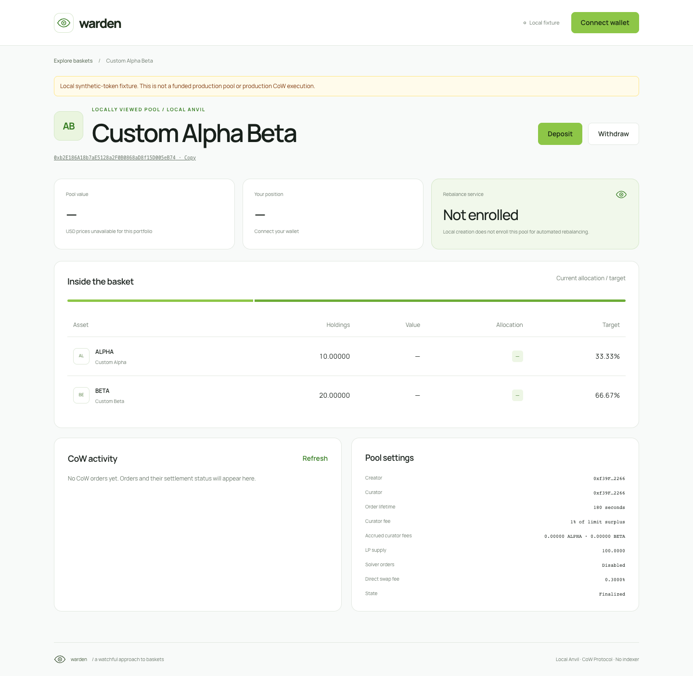

# Custom portfolios

Warden supports the existing MAG7 preset and custom portfolios on the configured network. This is an app/service change; the existing factory and pool contracts already support custom token sets and weights. No new contract deployment or environment variable is required.

## Create and initialize

Choose **Create a basket → Custom portfolio**. Enter 2–8 token contract addresses and percentage weights, then select **Read tokens and apply weights**. Warden validates addresses, uniqueness and weights before reading contract code, decimals, symbol and name through RPC. Name/symbol metadata may fall back to generic labels; decimals must be readable. Native BNB/ETH is not an ERC-20 token: use its wrapped token address.

Weights accept two decimal places, must total exactly 100%, and must each be at least 2%. Custom portfolios use a total denormalized contract weight of 50: `denorm = percentage / 2`. For example, 33.33% / 66.67% maps exactly to 16.665 / 33.335. Contract weights are encoded with 18 decimals and remain fixed after finalization. The MAG7 preset retains its existing weights and total denormalized weight of 40.

Enter human-readable seed amounts for every token. The on-chain minimum remains 1,000,000 raw units per token. USD seed suggestions are available only when the server cache has fresh prices for all selected tokens; manual initialization works without prices. Initial token amounts determine the initial reserve composition independently of the fixed target weights.

Choose the pool name, LP symbol, curator, immutable public swap fee and optional solver access as before. The connected wallet approves and binds each seed, then finalizes the pool. A token address and readable metadata do not prove transfer behavior or CoW liquidity. Fee-on-transfer, rebasing and restricted tokens need compatibility checks before use.

## Recovery and liquidity

New setup drafts persist their complete ordered token metadata, weights and raw seed amounts in the existing browser cache. After rejection/reload, initialization uses that saved composition, validates already-bound weights, and resumes the same factory request without substituting the current MAG7 configuration. Old drafts without an asset list retain the legacy preset fallback.

Creation and incomplete setup remain local to the browser. Importing a known pool address still checks membership in the configured factory. Public visibility can be configured through `DEMO_POOLS` or the frontend-only list in `demo/web/lib/frontend-pools.ts`; automated rebalancing independently requires `CURATOR_POOLS` and the matching on-chain curator authority. The frontend-only BNB list includes WBNB-USDC at `0x44363bddb3fafd262a416567B7827e46D266F86D`. This listing does not change server environment settings, enroll it in curation, or extend the hourly server price watchlist.

Cards show the pool's own LP symbol and token count. The detail page reads its actual tokens, reserves and weights. Deposits require every constituent token and withdrawals return every constituent proportionally, including when USD valuation is unavailable. Liquidity calculations do not depend on CoinGecko.

## Prices and curator service

The hourly price watchlist includes the configured preset plus tokens read from pools explicitly registered in `DEMO_POOLS` or `CURATOR_POOLS`. Addresses are deduplicated. Browser creation/import/read requests do not add watchlist entries or trigger CoinGecko fetches. After updating the server lists and restarting, the next price fetch includes the portfolio's tokens.

The price cache retains available prices when CoinGecko lacks coverage for another token. A portfolio missing any required price shows its USD valuation as unavailable, without treating that token as zero. Freshness checks apply to the assets of the particular pool. The curator skips unpriced/stale portfolios and can continue with another priced portfolio.

Strict server snapshots accept finalized portfolios with 2–8 assets, valid contract weight bounds and the existing 180-second order duration. Curation uses the pool's on-chain weights and checks the configured signing authority, complete fresh pricing, curve-valid hook-aware quotes and projected drift reduction. It considers up to eight priority assets per cycle while keeping one active curator order across the worker. This change does not implement the separate proposed paired $0.10 minimum in `.scratch`.

## Validation

- `pnpm demo:build` and `pnpm demo:typecheck`.
- `pnpm test:demo`: weight boundaries/precision, duplicate addresses, seed validation, draft compatibility, registered-pool pricing, missing prices and per-pool curator skipping, alongside the existing service tests.
- `pnpm test:demo:browser`: existing MAG7 setup/recovery and wallet controls against the local Anvil fixture.
- `pnpm test:demo:custom-browser`: deploys two non-preset local tokens with 18/6 decimals; checks fractional weights, rejected initialization followed by reload/resume, unavailable USD prices, deposit/withdraw, local discovery and import. Requires the existing Anvil fixture and a running local server. It refuses production configurations.

Run browser journeys sequentially because they share the local fixture wallet. Set `DEMO_BROWSER_URL` for the local server and optionally `BROWSER_EXECUTABLE` for an installed Chrome/Chromium binary. Custom browser screenshots are written to `.local/custom-create-mobile.png` and `.local/custom-pool-desktop.png`. These local synthetic tokens and prices do not establish production token compatibility or live CoW liquidity.

The example below is a local Anvil pool with two synthetic tokens and no market-price coverage; it demonstrates holdings and target weights without implying live curation.

