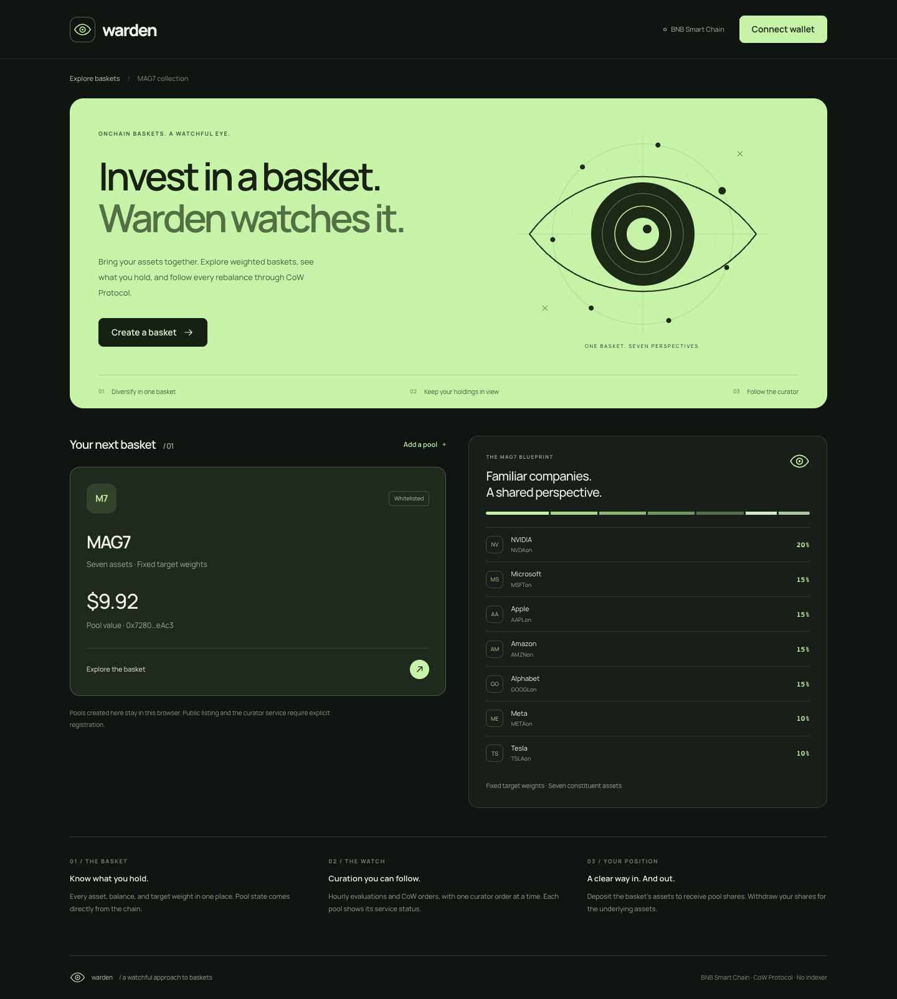
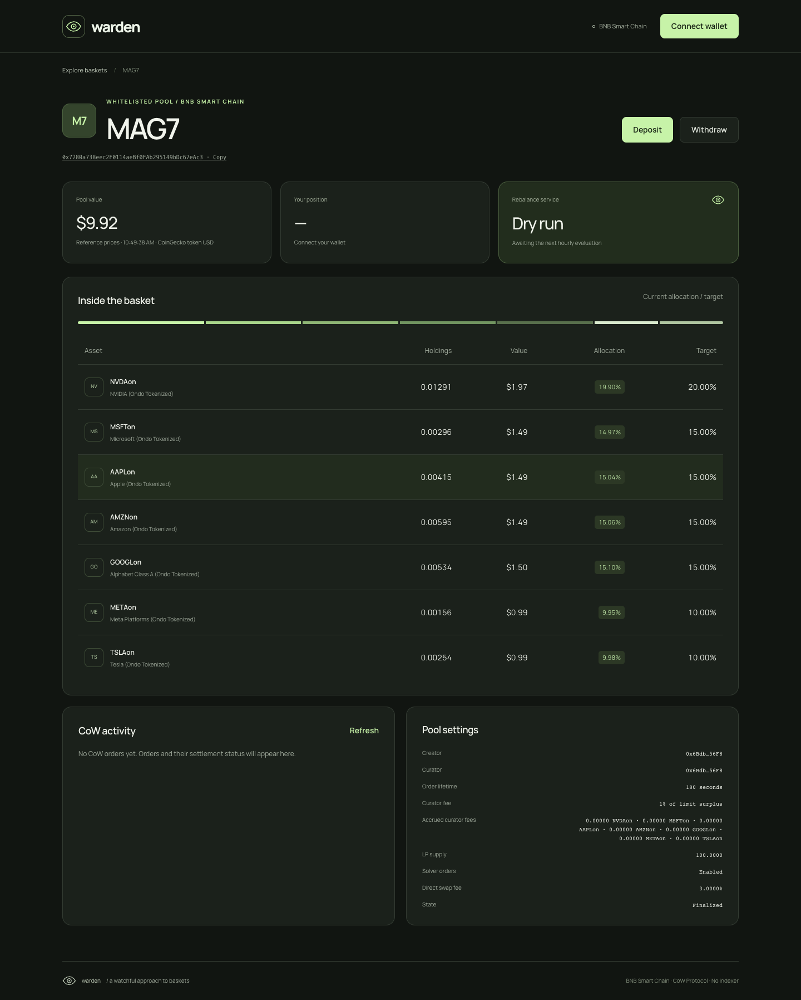

# Warden visual identity

**Invest in a basket. Warden watches it.**

Warden is the app identity for the existing weighted-pool demo. The basket brings the assets together; the eye represents visibility into holdings and the curator's work. The interface makes that promise concrete by keeping balances, allocations, target weights and service status in view.

## Visual direction

The eye is a small, recognizable outline in the wordmark, favicon and dialog header. On the explore page, it becomes a larger diagram: seven points orbit an iris, connecting the mark to the MAG7 basket. It is drawn with SVG so it stays sharp at every size.

Light green introduces the product and identifies primary actions. The rest of the app uses near-black and dark-gray surfaces with a slight green tint, quiet borders and off-white text. The pool dashboard is deliberately quieter than the introduction so numerical information leads. Green shades distinguish the allocation segments; the table also names each asset and shows numeric percentages.

| Role | Color |
| --- | --- |
| Primary green | `#c7f3a8` |
| Canvas | `#111511` |
| Surface | `#1b211b` |
| Main text | `#f1f4ec` |
| Secondary text | `#a0aa9c` |
| Borders | `#333b32` |

Manrope gives the wordmark and large headings a consistent shape while staying readable for asset names and figures. The Latin variable font is self-hosted with its SIL Open Font License; rendering does not require a request to a font provider.

## Page structure

The explore page opens with the promise and a create-basket action. Pool cards remain the entry point to existing pools, with whitelist/local labels, value and address. A separate MAG7 blueprint shows all seven configured assets and their target weights. Supporting copy explains onchain data, curator checks and proportional entry/exit.

The pool page keeps the pool name and full copyable address above deposit/withdraw actions. Three summary panels show pool value, the connected wallet's position, and rebalance service status. The holdings table retains all five columns: asset, holdings, value, allocation and target. CoW activity and pool settings follow it.

Every existing setting remains: creator, curator, order lifetime, curator fee, accrued fees for all assets, LP supply, solver policy, direct swap fee and initialization state. Creator actions and interrupted-setup recovery are retained. Creation, initialization, import, deposit, withdrawal, recovery and policy dialogs share the new theme.

## State and compatibility

The eye does not imply that every pool has a live curator. Connecting, offline, not-enrolled, dry-run and live worker states remain distinct. A first price fetch says “Loading market prices…”; an error says “CoinGecko prices unavailable.” Reference-price source, timestamp and stale labels remain visible. Startup waiting is described as waiting for previous orders to expire.

The redesign preserves the legacy browser cache key and catalog event, so existing locally saved pools and setup drafts remain available. Pool/contract names, addresses, weights, math, wallet transactions, canonical CoW appData and server configuration are unchanged. Creating a pool still requires all seven assets; public listing and curator enrollment remain separate.

## Responsive behavior and review

On narrow screens the hero, catalog and summary panels stack. Holdings scroll within their table container, keeping all columns available. Dialogs remain bounded by the viewport. Keyboard focus has a visible green outline, decorative artwork is hidden from assistive technology, and reduced-motion preferences are honored.

Validation includes a production Next build, strict TypeScript check, the deterministic demo test suite, the local browser transaction journey, and the BNB wallet-network/preset browser check. Visual review also checks desktop, 390px and 360px widths, all seven holdings, all five columns, all nine settings, enabled liquidity controls and loading/error/service states.

The screenshots below use a read-only snapshot of the configured BNB MAG7 pool and CoinGecko prices captured on November 27, 2026. Wallet is disconnected. Service state is a dry-run presentation fixture and the activity list is empty; these images do not document live curator execution.

Run `pnpm dev` with the existing `.env` to view the app. This visual change adds no environment variables or deployment steps.
